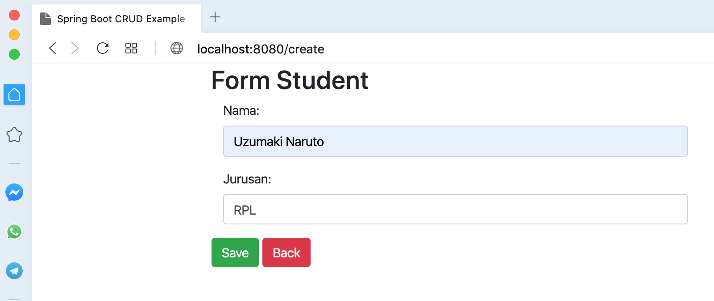
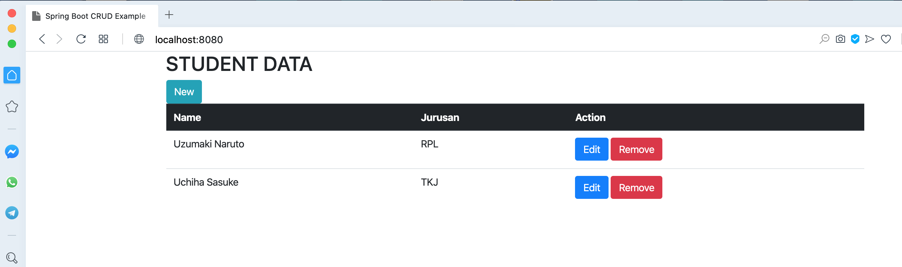

# springboot-thymeleaf-postgres

[](https://github.com/hendisantika/springboot-thymeleaf-postgres/actions/workflows/maven.yml)


Simple Student CRUD web application built with Spring Boot, Thymeleaf, Spring Data JPA and PostgreSQL.

## Tech Stack

| Component        | Version / Tool                          |
|------------------|-----------------------------------------|
| Java             | 25                                      |
| Spring Boot      | 4.1.x                                   |
| Template engine  | Thymeleaf + Bootstrap                   |
| Persistence      | Spring Data JPA (Hibernate)             |
| Database         | PostgreSQL                              |
| Build tool       | Maven (wrapper included)                |
| Others           | Lombok, Docker, Kubernetes manifests    |

## Prerequisites

- JDK 25 (e.g. `sdk install java 25-tem`)
- PostgreSQL running on `localhost:5432` with a database named `student`
- Docker (optional)

## Configuration

Database settings live in `src/main/resources/application.properties`:

```properties
spring.datasource.url=jdbc:postgresql://localhost:5432/student
spring.datasource.username=postgres
spring.datasource.password=hendi34
```

They can be overridden with environment variables, for example:

```shell
export SPRING_DATASOURCE_URL=jdbc:postgresql://localhost:5432/student
export SPRING_DATASOURCE_USERNAME=postgres
export SPRING_DATASOURCE_PASSWORD=postgres
```

## Things to do

1. Clone the repository: `git clone https://github.com/hendisantika/springboot-thymeleaf-postgres.git`
2. Go to folder: `cd springboot-thymeleaf-postgres`
3. (Optional) Start PostgreSQL with Docker:
   ```shell
   docker run -d --name postgres -p 5432:5432 \
     -e POSTGRES_USER=postgres -e POSTGRES_PASSWORD=hendi34 -e POSTGRES_DB=student \
     postgres:17-alpine
   ```
4. Run application: `./mvnw clean spring-boot:run`
5. Open your browser: http://localhost:8080

### Endpoints

| Method | Path          | Description             |
|--------|---------------|-------------------------|
| GET    | `/`           | List all students       |
| GET    | `/create`     | Show add student form   |
| POST   | `/create`     | Save student            |
| GET    | `/edit/{id}`  | Show edit student form  |
| GET    | `/hapus/{id}` | Delete student          |

## Build & Test

The test suite boots the full Spring context, so a PostgreSQL database must be reachable.

```shell
./mvnw clean package
```

## Docker

```shell
./mvnw clean package -DskipTests
docker build -t springboot-thymeleaf-postgres:latest .
```

The image is based on `bellsoft/liberica-openjdk-debian:25` and runs with the `k8s` Spring profile
(`DB_HOST`, `DB_NAME`, `POSTGRES_USER`, `POSTGRES_PASSWORD` environment variables are required).

## Continuous Integration

GitHub Actions ([`.github/workflows/maven.yml`](.github/workflows/maven.yml)) builds and tests the project on JDK 25
against a PostgreSQL 17 service container for every push and pull request to `master`, then submits the Maven
dependency graph to GitHub.

## Dependency Updates

Dependabot ([`.github/dependabot.yml`](.github/dependabot.yml)) keeps these up to date:

- **Maven** — daily, grouped into `spring-boot`, `maven-plugins` and `minor-and-patch`
- **GitHub Actions** — weekly, grouped into a single PR
- **Docker** base image — weekly (major JDK upgrades are done manually)

## Screen shot





## Kubernetes Command

```shell
kubectl apply -f k8s/postgres-configmap.yml
kubectl get configmap
kubectl apply -f k8s/postgres-credentials.yml
kubectl get secret
kubectl describe secret postgres-credentials
```

### Execute file deployment PostgreSQL database

```shell
kubectl apply -f k8s/postgres-deployment.yml
kubectl get deployment
kubectl get pod
kubectl logs -f postgres-77977dd68f-4dwjz
kubectl port-forward postgres-77977dd68f-4dwjz 5433:5432
```

### Deploy the application

```shell
docker build -t backend-service-k8s:1.0 .
kubectl apply -f k8s/app-deployment.yml
kubectl get svc
```
